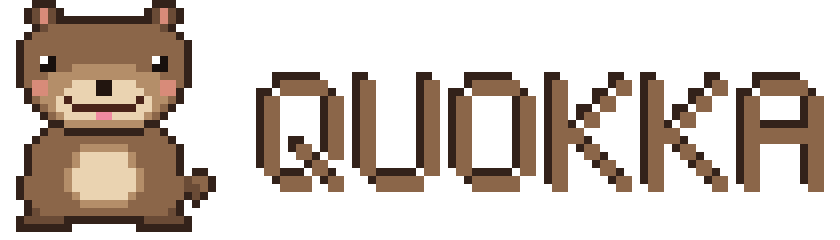
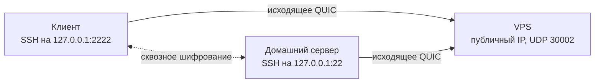

<div align="center">

<picture>
  <source media="(prefers-color-scheme: dark)" srcset="assets/quokka-logo-dark.svg">
  
</picture>

**Защищённая mesh-сеть для игр и программ**


</div>

---

Quokka соединяет устройства в одну защищённую сеть и позволяет открывать между ними отдельные TCP- и
UDP-порты. Например, можно подключиться по SSH к домашнему серверу за NAT, не пробрасывая порты на роутере.

Все узлы равны. Если два устройства не могут соединиться напрямую, трафик идёт через узел, который видит обоих,
например через VPS. Промежуточный узел видит маршрут и объём трафика, но не его содержимое.

## Содержание

- [Быстрый старт](#быстрый-старт)
- [Развертывание: VPS, домашний сервер и клиент](#развертывание-vps-домашний-сервер-и-клиент)
- [Установка](#установка)
- [Автозапуск на Linux](#автозапуск-на-linux)
- [Файл конфигурации](#файл-конфигурации)
- [Команды и параметры](#команды-и-параметры)
- [Безопасность](#безопасность)
- [Ограничения](#ограничения)
- [Разработка](#разработка)

## Быстрый старт

На первом устройстве создайте сеть и откройте ей TCP-порт `8000` локального сервиса:

```bash
quokka up --tcp 8000 --name server
```

Quokka напечатает короткий код приглашения. На втором устройстве выполните:

```bash
quokka join --name client --open server:8000=9000
```

Введите код по запросу — так он не останется в истории shell. После подключения сервис первого устройства будет
доступен на втором по адресу `127.0.0.1:9000`.

Оба процесса должны оставаться запущенными. Остановка выполняется через `Ctrl+C`.

Код одноразовый и действует 15 минут. Для следующего устройства получите новый код на любом запущенном узле:

```bash
quokka invite
```

Настройки сохраняются автоматически. При следующем запуске приглашение не нужно:

```bash
quokka
```

## Развертывание: VPS, домашний сервер и клиент

Это основной сценарий для доступа к компьютеру с серым IP:



Дальше используются:

- `vps.example.com` — адрес VPS; замените его на свой домен или IP;
- `home` — имя домашнего узла;
- `2222` — локальный порт на клиенте для подключения к домашнему SSH.

### 1. Установите Quokka на все три машины

Проще всего установить DEB-пакет на Debian 13 или Ubuntu 25.04+. Другие варианты описаны в разделе
[Установка](#установка).

Проверьте установку:

```bash
quokka --help
```

### 2. Запустите VPS

Откройте в файрволе VPS входящий **UDP-порт `30002`**. TCP-порт для Quokka не нужен.

```bash
quokka server \
  --public vps.example.com \
  --port 30002 \
  --name vps \
  --save home
```

При первом запуске будет создана сеть и напечатан короткий код. Оставьте процесс работающим.

Здесь `home` — имя сохранённого профиля сети, а не имя узла. Оно понадобится для автозапуска.

### 3. Подключите домашний сервер

Выполните на домашнем сервере, подставив код с VPS:

```bash
quokka join КОД \
  --peer vps.example.com:30002 \
  --tcp 22 \
  --name home \
  --save home
```

Либо запустите `quokka join` без кода и введите его по запросу:

```bash
quokka join \
  --peer vps.example.com:30002 \
  --tcp 22 \
  --name home \
  --save home
```

Опция `--tcp 22` открывает участникам сети только SSH-сервер домашней машины. Сам SSH должен быть запущен и
принимать подключения на `127.0.0.1:22`.

### 4. Подключите клиент

На VPS или домашнем сервере выдайте новое приглашение:

```bash
quokka invite
```

Выполните на клиенте:

```bash
quokka join \
  --peer vps.example.com:30002 \
  --name laptop \
  --open home:22=2222 \
  --save home
```

После появления сообщения о готовности порта подключитесь из второго терминала:

```bash
ssh -p 2222 user@127.0.0.1
```

Имя узла выбирает сам узел и не является подтверждённым идентификатором. Для строгой привязки заранее найдите
идентификатор домашнего узла в `quokka status` на VPS или домашнем сервере. Затем в приведённой выше команде `join`
замените `home:22=2222` на `ИДЕНТИФИКАТОР:22=2222`. Если клиент уже подключён, измените правило `open` в его
`config.toml` и перезапустите Quokka.

### 5. Настройте автозапуск

После проверки остановите запущенные вручную процессы через `Ctrl+C` и настройте службы по инструкции
[Автозапуск на Linux](#автозапуск-на-linux).

### Проверка состояния

На любом узле:

```bash
quokka status
```

Вы должны увидеть остальные узлы, способ подключения и задержку. На клиенте также должен быть открыт локальный
TCP-порт `2222`.

Если узлы не соединяются, проверьте:

1. Доступен ли с VPS UDP-порт `30002`.
2. Совпадает ли адрес в `peers` с фактическим адресом VPS.
3. Запущены ли процессы Quokka на обоих узлах.
4. Не блокирует ли сеть исходящий UDP.

## Установка

### DEB-пакет для Linux

Для сборки нужен Docker с Buildx. Пакет собирается внутри контейнера, поэтому toolchain на хосте не требуется.

Для Linux AMD64:

```bash
docker buildx build \
  --platform linux/amd64 \
  --target export-deb \
  --build-arg PACKAGE_VERSION=1.0.0 \
  -o dist/deb .
```

Для Linux ARM64:

```bash
docker buildx build \
  --platform linux/arm64 \
  --target export-deb \
  --build-arg PACKAGE_VERSION=1.0.0 \
  -o dist/deb .
```

Результат:

```text
dist/deb/quokka_1.0.0_amd64.deb
# или
dist/deb/quokka_1.0.0_arm64.deb
```

Скопируйте пакет на целевую машину и установите:

```bash
sudo apt install ./quokka_1.0.0_amd64.deb
quokka --help
```

Пакет устанавливает `/usr/bin/quokka` и `libmsquic`. Он рассчитан на **Debian 13 / Ubuntu 25.04 и новее**:
нужны glibc ≥ 2.41 и OpenSSL 3.5. Конфигурация и systemd-служба в пакет не входят.

### Из исходников на macOS

```bash
brew install cmake boost openssl libmsquic
cmake -S . -B build
cmake --build build
```

Бинарник появится в `build/quokka`. Запуск без установки:

```bash
./build/quokka --help
```

Установка в `/usr/local`:

```bash
sudo cmake --install build --prefix /usr/local
```

### Из исходников на Linux

Зависимости:

| Зависимость | Версия |
|---|---|
| Компилятор | Поддержка C++26: Clang, Apple Clang или GCC 14+ |
| CMake | ≥ 4.2.3 |
| Boost | Только заголовки, Asio |
| OpenSSL | 3.x или 4.x; для Linux-сборки MsQuic — 3.5+ |
| [MsQuic](https://github.com/microsoft/msquic) | 2.x |

После установки зависимостей:

```bash
cmake -S . -B build
cmake --build build
sudo cmake --install build --prefix /usr/local
```

Если MsQuic установлен в нестандартный каталог, добавьте его при настройке:

```bash
cmake -S . -B build -DCMAKE_PREFIX_PATH=/путь/к/msquic
```

### Docker на VPS

Docker-образ сам собирает необходимые зависимости:

```bash
docker build --target runtime -t quokka .
docker run -d \
  --name quokka \
  --restart=always \
  --network host \
  -v quokka-data:/data \
  quokka server --public vps.example.com --port 30002
```

Том `quokka-data` хранит ключи узла и сохранённые сети. Контейнер работает без прав root.

Полезные команды:

```bash
docker exec quokka quokka invite
docker exec quokka quokka status
docker logs -f quokka
```

## Автозапуск на Linux

Ниже настраивается пользовательская systemd-служба. Она подходит и для VPS, и для домашнего сервера, если профиль
сети называется `home`, а бинарник установлен как `/usr/bin/quokka`.

Перед настройкой завершите ручной запуск Quokka через `Ctrl+C`: два процесса с одним `QUOKKA_HOME` запускать нельзя.

### 1. Создайте службу

Выполните под пользователем, от которого должен работать узел:

```bash
mkdir -p ~/.config/systemd/user
cat > ~/.config/systemd/user/quokka.service <<'EOF'
[Unit]
Description=Quokka mesh node
After=network-online.target
Wants=network-online.target

[Service]
Environment=QUOKKA_HOME=%h/.config/quokka
WorkingDirectory=%h
ExecStart=/usr/bin/quokka connect home
Restart=always
RestartSec=3
NoNewPrivileges=true
PrivateTmp=true

[Install]
WantedBy=default.target
EOF
```

Если бинарник находится в `/usr/local/bin/quokka` или используется другой `QUOKKA_HOME`, измените соответствующие
строки в unit-файле.

### 2. Включите службу и запуск до входа пользователя

```bash
systemctl --user daemon-reload
systemctl --user enable --now quokka.service
sudo loginctl enable-linger "$USER"
```

Последняя команда обязательна для сервера: без linger пользовательская служба может запускаться только после
SSH-входа и останавливаться после завершения всех сессий пользователя.

Проверьте:

```bash
systemctl --user is-active quokka.service
systemctl --user is-enabled quokka.service
loginctl show-user "$USER" -p Linger
quokka status
```

Ожидаемые результаты: `active`, `enabled`, `Linger=yes`.

### 3. Управление и журналы

```bash
systemctl --user restart quokka.service
systemctl --user stop quokka.service
systemctl --user start quokka.service
journalctl --user -u quokka.service -f
```

После изменения `config.toml` перезапустите службу. После изменения unit-файла выполните
`systemctl --user daemon-reload`, затем перезапустите службу.

В репозитории также есть [deploy/quokka.service](deploy/quokka.service) — пример системной службы для установки в
`/opt/quokka` и запуска отдельным системным пользователем.

## Файл конфигурации

По умолчанию настройки и секреты лежат в:

```text
~/.config/quokka/config.toml
~/.config/quokka/node.secret
```

Каталог можно изменить переменной `QUOKKA_HOME`:

```bash
QUOKKA_HOME=/путь/к/каталогу quokka list
```

`config.toml` содержит постоянный ключ сети. Не публикуйте файл и не добавляйте его в Git. Права должны быть `0600`:

```bash
chmod 600 ~/.config/quokka/config.toml
```

### Примеры профилей

Все три машины должны использовать **один и тот же** `code`. Постоянный ключ существующей сети можно получить на
запущенном узле:

```bash
quokka invite --full
```

Обычно файлы создаются командами `up`, `server` и `join`; вручную их редактировать не обязательно.

**Домашний сервер:**

```toml
default = "home"

[network.home]
code = "quokka2..."
name = "home"
peers = ["vps.example.com:30002"]
tcp = [22]
```

**VPS:**

```toml
default = "home"

[network.home]
code = "quokka2..."
name = "vps"
public = "vps.example.com"
port = 30002
discovery = false
```

**Клиент:**

```toml
default = "home"

[network.home]
code = "quokka2..."
name = "laptop"
peers = ["vps.example.com:30002"]
open = ["home:22=2222"]
```

Значение `quokka2...` — только шаблон: замените его настоящим постоянным ключом.

### Настройки профиля

Все настройки необязательны, кроме `code`.

| Параметр | По умолчанию | Назначение |
|---|---|---|
| `code` | — | Постоянный ключ сети |
| `name` | Имя машины | Имя узла, видимое остальным |
| `peers` | `[]` | Адреса, к которым нужно подключаться всегда |
| `tcp` | `[]` | Свои TCP-порты, открытые сети |
| `udp` | `[]` | Свои UDP-порты, открытые сети |
| `open` | `[]` | Чужие сервисы, которые нужно открыть локально |
| `public` | — | Публичный адрес узла; подставляется в приглашения |
| `port` | `30002` | UDP-порт QUIC |
| `relay` | `true` | Передавать транзитный трафик других узлов |
| `discovery` | `true` | Искать соседей в локальной сети |
| `discovery_port` | `30001` | UDP-порт автопоиска |
| `multicast_ip` | `239.255.0.1` | Группа автопоиска |
| `listeners` | Без ограничений | Максимум прямых входящих соединений |

Пример с несколькими сервисами:

```toml
default = "home"

[network.home]
code = "quokka2..."
name = "laptop"
peers = ["vps.example.com"]
tcp = [22, 8000]
udp = [27015]
open = ["server:8000=9000", "27015"]
relay = false
discovery = false
listeners = 8
```

Если сохранено несколько сетей, `default` выбирает сеть для запуска без аргументов. Опечатка в файле приводит к
ошибке с номером строки.

## Команды и параметры

### Основные команды

| Команда | Назначение |
|---|---|
| `quokka` | Выбрать сохранённую сеть и подключиться |
| `quokka up` | Запустить узел; при первом запуске создать сеть |
| `quokka server` | Запустить VPS-узел с выключенным автопоиском |
| `quokka join [КОД]` | Войти в сеть; без аргумента код запрашивается интерактивно |
| `quokka connect ИМЯ` | Подключиться к сохранённой сети |
| `quokka invite` | Выдать приглашение на работающем узле |
| `quokka status` | Показать соседей, маршруты и открытые порты |
| `quokka list` | Показать сохранённые сети |

### Параметры запуска

Работают в `up`, `server`, `join` и `connect`. В `connect` параметры дополняют сохранённые настройки только на один
запуск и не изменяют файл.

| Параметр | Назначение |
|---|---|
| `--tcp ПОРТ` | Открыть сети TCP-порт этой машины; можно повторять |
| `--udp ПОРТ` | Открыть сети UDP-порт этой машины; можно повторять |
| `--open ПРАВИЛО` | Открыть сервис сети на локальном адресе; можно повторять |
| `--peer АДРЕС[:ПОРТ]` | Всегда подключаться к указанному узлу; можно повторять |
| `--public АДРЕС` | Публичный адрес узла |
| `--name ИМЯ` | Имя узла |
| `--port ПОРТ` | UDP-порт QUIC; по умолчанию `30002` |
| `--no-discovery` | Выключить автопоиск соседей |
| `--no-relay` | Запретить передачу чужого трафика |
| `--listeners N` | Ограничить число прямых входящих соединений |
| `--discovery-port ПОРТ` | Изменить UDP-порт автопоиска |
| `--multicast-ip IP` | Изменить группу автопоиска |
| `--save ИМЯ` | Сохранить настройки под указанным именем профиля |
| `-v`, `--verbose` | Подробный журнал |

Только `up` и `server`: `--new-invite` создаёт новую сеть вместо использования сохранённой.

Только `join`: `--no-save` не сохраняет профиль. Для автоматизации код можно передать через `QUOKKA_INVITE`.

Только `invite`:

```bash
quokka invite --uses 3 --ttl 2h
quokka invite --full
```

`--full` печатает постоянный ключ сети, а не одноразовый код. Передавайте его только доверенным устройствам.

### Правила `--open`

| Запись | Что открывается |
|---|---|
| `--open 8000` | Сервис с портом `8000` на свободном локальном порту |
| `--open 8000=9000` | Сервис с портом `8000` на `127.0.0.1:9000` |
| `--open server:8000` | Сервис узла с именем `server` |
| `--open ab12cd34:8000` | Сервис узла с указанным началом идентификатора |
| `--open all` | Все объявленные сервисы сети |

Если локальный порт занят и явный `=ЛОКАЛЬНЫЙ` не задан, Quokka выберет свободный порт и напечатает его. Если явный
локальный порт занят, запуск завершится ошибкой.

## Безопасность

- Соседи проверяют общий ключ сети через QUIC/TLS 1.3.
- Конечные узлы дополнительно устанавливают сквозной Noise-канал: промежуточный узел не читает TCP/UDP-трафик.
- Личные ключи узлов подписывают карту сети и защищают идентификаторы от подмены.
- Без `--tcp` и `--udp` локальные сервисы участникам недоступны; без `--open` чужие порты локально не открываются.
- Короткий код нельзя перебрать офлайн; после 10 неверных попыток он сгорает.

Важные ограничения:

- Ключ сети общий, поэтому отдельного участника отозвать нельзя. При компрометации создайте новую сеть через
  `quokka up --new-invite` и заново подключите доверенные устройства.
- VPS — такой же участник сети. Его взлом даёт атакующему ключ сети, хотя содержимое сквозных каналов остаётся
  зашифрованным.
- Имена узлов не подтверждены. Если участники не доверяют друг другу, используйте идентификаторы в `--open`.
- Сервисы должны иметь собственную аутентификацию: Quokka не заменяет пароли или ключи SSH.
- Секреты на диске защищены правами файлов, но не зашифрованы.

Внешнего аудита и фаззинга не было. Подробная модель угроз: [docs/SECURITY.md](docs/SECURITY.md).

## Ограничения

- Нет пробивания NAT: два узла с серыми IP общаются через доступный обоим узел, обычно VPS.
- Нужен исходящий UDP. Сети, полностью блокирующие UDP, не поддерживаются.
- Поддерживается только IPv4.
- Поиск LAN-серверов игр через широковещательные пакеты не пробрасывается; указывайте `127.0.0.1:порт` вручную.
- При обрыве пути TCP-подключение разрывается. UDP-сессия создаётся заново при следующем пакете, и сервер может
  увидеть другой порт отправителя.
- Сквозной заголовок занимает 69 байт, поэтому слишком крупные UDP-пакеты отбрасываются.
- Узлы разных несовместимых версий протокола не соединяются. Старые коды `quokka1`, команда `point` и файл
  `network.invite` не поддерживаются.

## Разработка

Архитектура, протокол и правила изменения кода: [docs/ARCHITECTURE.md](docs/ARCHITECTURE.md).

Сборка и тесты:

```bash
cmake -S . -B build -DQUOKKA_BUILD_TESTS=ON
cmake --build build
ctest --test-dir build --output-on-failure
```

Проверка настоящего NAT в Docker:

```bash
tests/nat_test.sh
```
