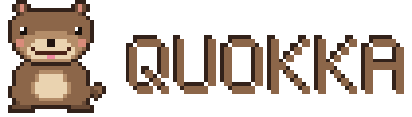
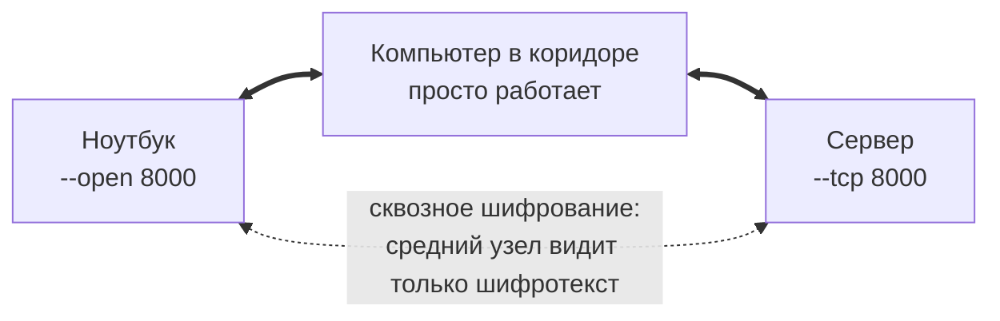

<div align="center">

<picture>
  <source media="(prefers-color-scheme: dark)" srcset="assets/quokka-logo-dark.svg">
  
</picture>

**Защищённая mesh-сеть для игр и программ**

Все устройства равны: каждое может открывать свои порты, пользоваться чужими и передавать трафик
других устройств. Если двое не видят друг друга напрямую, связь идёт через тех, кто видит обоих.
Без регистрации, серверов, прав администратора и настройки сертификатов.


</div>

---

## Быстрый старт

Например, на вашей машине сервис работает на порту `8000`:

```bash
quokka up --tcp 8000
```

Программа создаст сеть и напечатает готовую команду. Выполните её на другом устройстве:

```bash
quokka join quokka2... --open 8000
```

Когда появится `TCP 8000 узла ... готов: подключайтесь к 127.0.0.1:8000`, откройте этот адрес на
втором устройстве. Готово.

Устройства находят друг друга в локальной сети сами. При следующих запусках хватит `quokka up`
на любом из них: код сохраняется, его можно посмотреть в выводе любого участника.

## Как это работает



- **Каждый клиент — ещё и сервер.** Роли «главного» узла нет, сеть не зависит ни от кого одного.
- **Передача через других.** Каждый узел знает карту сети и сам выбирает кратчайший путь. Узлов на
  пути может быть несколько.
- **Обход отказов.** Если узел на пути пропал, трафик за несколько секунд идёт другим путём, если он есть.
- **Промежуточные узлы ничего не читают.** Шифрование идёт от отправителя до получателя.

| | |
|---|---|
| **UDP игр** | через QUIC datagrams, без повторной отправки и очередей, как обычный UDP |
| **TCP-подключения** | через QUIC-потоки, с контролем скорости на всём пути |
| **Защита** | взаимная проверка на каждом соединении и Noise между конечными узлами |
| **Локально** | игра подключается к `127.0.0.1` и ничего не знает о сети |

## Установка

### macOS

```bash
brew install cmake boost openssl libmsquic
cmake -S . -B build
cmake --build build
sudo cmake --install build --prefix /usr/local  # необязательно
```

Бинарник появится в `build/quokka`.

### Linux x86_64 и ARM64 через Docker

Dockerfile сам ставит MsQuic и CMake нужной версии.

```bash
# Бинарники в ./dist/linux_amd64 и ./dist/linux_arm64 (рядом лежит libmsquic.so.2)
docker buildx build --platform linux/amd64,linux/arm64 --target export -o dist .

# Или готовый образ
docker build --target runtime -t quokka .
docker run --rm --network host -v quokka-data:/data quokka up --tcp 8000
```

Том `quokka-data` хранит ключи узла и код сети. Контейнер работает без прав root.

> [!NOTE]
> Бинарники из `dist` собраны на Debian 13 и требуют glibc ≥ 2.41 и OpenSSL 3.5 (Debian 13,
> Ubuntu 25.04 и новее). На более старых системах запускайте Docker-образ.

### Зависимости для сборки вручную

| Что | Версия |
|---|---|
| Компилятор | с поддержкой C++26: Apple Clang, Clang или GCC 14+ |
| CMake | ≥ 4.2.3 |
| Boost | только заголовки (Asio) |
| OpenSSL | 3.x или 4.x (для Linux-сборки MsQuic — 3.5+) |
| [MsQuic](https://github.com/microsoft/msquic) | 2.x |

## Примеры

### Устройства далеко друг от друга

Автопоиск работает только в пределах одной сети. Если сегменты разделены, нужен узел, который видит
оба, например с двумя сетевыми картами или с адресом, доступным из обоих сегментов:

```bash
quokka up                                 # посредник, адрес 10.0.0.5
quokka join КОД --peer 10.0.0.5 --tcp 8000       # сервер из одного сегмента
quokka join КОД --peer 10.0.0.5 --open 8000      # клиент из другого
```

На посреднике ничего настраивать не нужно. Любой узел передаёт чужой трафик автоматически.

### Сервисы в обе стороны

У каждого свои порты, каждый пользуется чужими:

```bash
quokka up --tcp 8000 --open 7777
quokka join КОД --udp 7777 --open 8000
```

### Открыть сервисы сети

Чужие порты по умолчанию на машине не открываются, в логе лишь сообщается, какие есть:

```
[Сервис] В сети есть TCP 8000 на узле server (ab12cd34). Чтобы пользоваться им здесь, добавьте --open 8000
```

| Запись | Что открывает |
|---|---|
| `--open 8000` | Сервис с портом 8000 на `127.0.0.1:8000` |
| `--open 8000=9000` | То же, на локальном порту 9000 |
| `--open server:8000` | Сервис узла с именем `server` |
| `--open ab12cd34:8000` | Сервис узла с таким началом идентификатора: это надёжнее имени |
| `--open all` | Все сервисы сети |

Если локальный порт занят, Quokka выберет свободный и напечатает его. С явным `=ЛОКАЛЬНЫЙ` это
считается ошибкой.

### Ограничить входящие соединения

```bash
quokka up --listeners 8
```

По умолчанию ограничений нет. Счёт идёт по прямым входящим соединениям этого узла. Посторонние мест
не занимают.

### Отозвать доступ

Код один на всю сеть. Чтобы отозвать его, создайте новую сеть и переведите в неё всех нужных:

```bash
quokka up --new-invite
quokka join НОВЫЙ_КОД
```

## Команды

### `quokka up` и `quokka join`

Опции у них общие. `up` использует сохранённую сеть или создаёт новую, `join` входит в сеть по коду.

| Аргумент | По умолчанию | Назначение |
|---|---|---|
| `--udp ПОРТ` | — | Открыть сети UDP-порт этой машины, можно несколько раз |
| `--tcp ПОРТ` | — | Открыть сети TCP-порт этой машины, можно несколько раз |
| `--open ПРАВИЛО` | — | Открыть сервис сети здесь, см. таблицу выше, можно несколько раз |
| `--peer IP[:ПОРТ]` | — | Всегда подключаться к этому адресу, можно несколько раз |
| `--no-discovery` | — | Не искать соседей автоматически |
| `--listeners N` | без ограничений | Максимум прямых входящих соединений |
| `--name ИМЯ` | имя машины | Имя узла, видимое остальным |
| `--port ПОРТ` | `30002` | UDP-порт QUIC. Без этой опции занятый порт заменяется свободным |
| `--discovery-port ПОРТ` | `30001` | UDP-порт автопоиска |
| `--multicast-ip IP` | `239.255.0.1` | Группа автопоиска |
| `-v`, `--verbose` | — | Подробный лог |

Только `up`: `--new-invite` создаёт новую сеть с новым кодом.

Только `join`: `КОД`, необязателен, если сохранён или будет запрошен; `--no-save` не запоминает код.
Ввод кода по запросу безопаснее: он не попадёт в историю команд. Для автоматического запуска есть
переменная `QUOKKA_INVITE`. Переменная `QUOKKA_HOME` задаёт папку с ключами (по умолчанию
`~/.config/quokka`).

## Безопасность

- **Код приглашения — это пропуск.** Кто его знает, тот входит в сеть, и код могут передать дальше.
  Передавайте его только по доверенному каналу.
- **Посредник не прочитает и не подменит трафик.** Получатель проверяется по ключу из подписанной
  карты сети, и подмена рвёт соединение до передачи данных.
- **Открыто только указанное.** Без `--udp` и `--tcp` до вашей машины не достучаться ни одному
  участнику, без `--open` на ней не откроется ни один чужой порт.
- **Участники видят метаданные.** Посредник знает, кто с кем и сколько передаёт, а все участники знают
  карту сети, но не содержимое.
- **`--open` доверяет объявлению сервиса.** Без указания узла порт достанется первому, кто его
  объявит. Если в сети могут быть недобросовестные участники, указывайте идентификатор узла.

Модель угроз и ограничения: [docs/SECURITY.md](docs/SECURITY.md).

## Ограничения

- **Нет прохода через NAT и релеев в интернете.** Соединение между соседями требует прямой доступности
  по UDP. Нужен хотя бы один узел, до которого могут дотянуться обе стороны.
- **Изоляция клиентов.** Если Wi-Fi изолирует устройства друг от друга, напрямую они не соединятся.
- **Только IPv4.**
- **Размер пакета.** Сквозной заголовок занимает 69 байт, поэтому UDP-пакет вмещает примерно 1130–1380
  байт. Более крупные отбрасываются. На пути учитывается самое узкое звено.
- **Смена пути для UDP.** Если отказ разорвал сессию, следующий пакет создаст новую: игровой сервер
  увидит клиента с другого порта. TCP-подключения через упавший узел обрываются.
- **Поиск серверов в игре.** Широковещательный поиск LAN-серверов через сеть не проходит: адрес
  `127.0.0.1:<порт>` вводится вручную.
- **Несовместимо с прошлыми версиями.** Команды `point`, `--accept-ports`, `--map` и коды `quokka1`
  больше не работают.

## Разработка

Устройство кода, протокол и то, как добавить новый модуль:
[docs/ARCHITECTURE.md](docs/ARCHITECTURE.md).

```bash
cmake -S . -B build -DQUOKKA_BUILD_TESTS=ON
cmake --build build
ctest --test-dir build --output-on-failure
```
