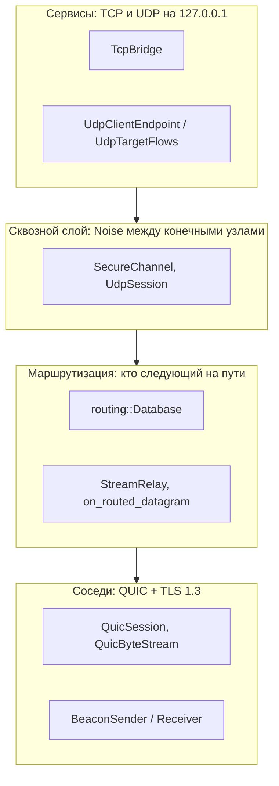
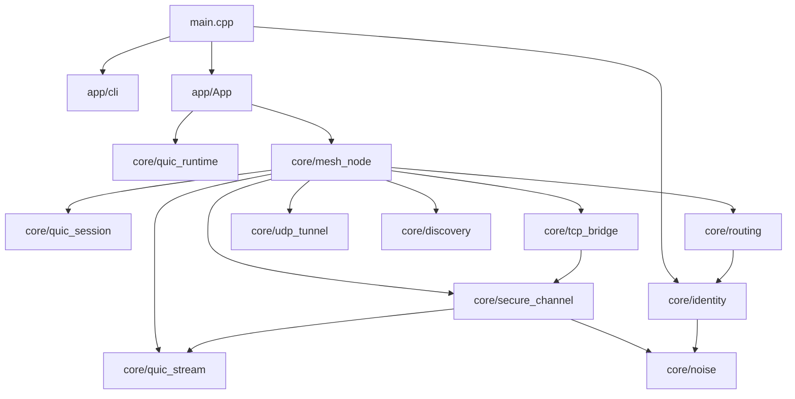
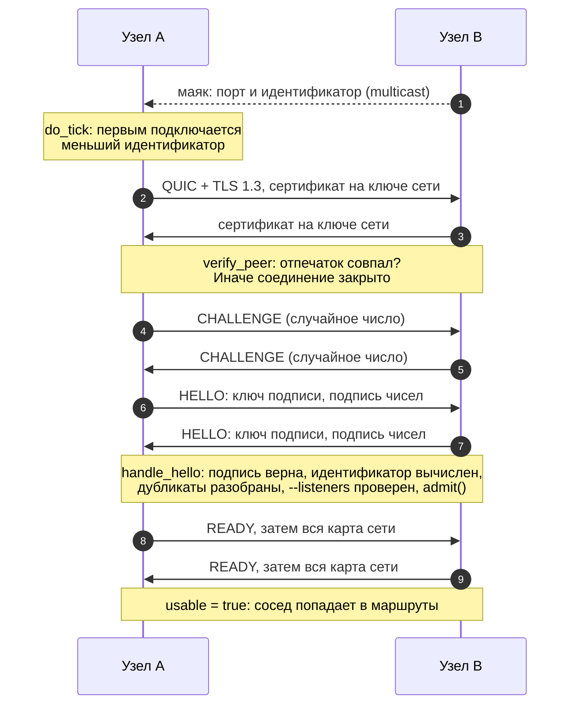
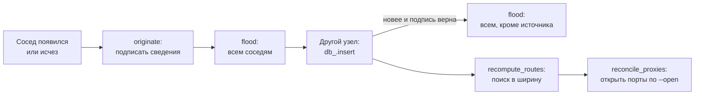
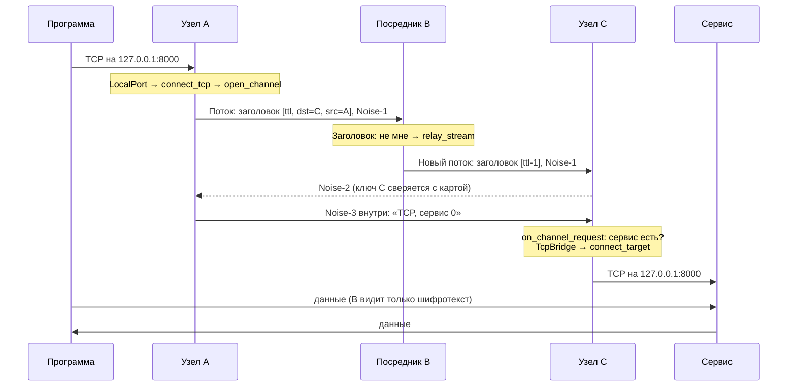
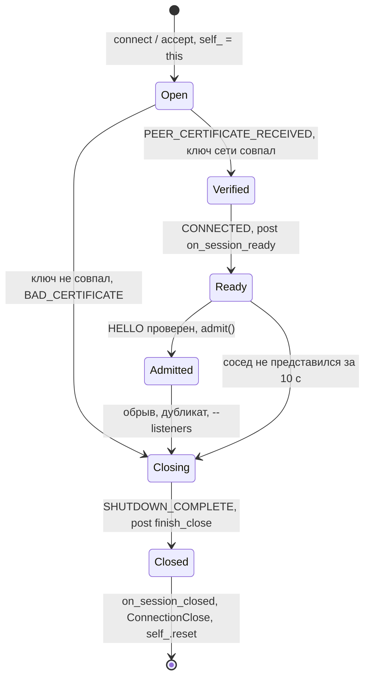
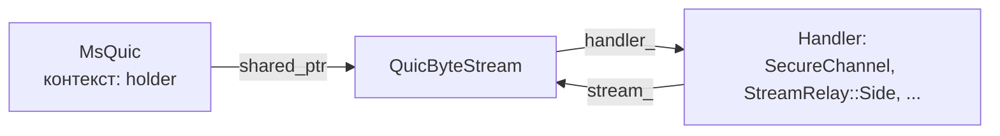

# Quokka: устройство кода

Документ для тех, кто собирается менять код или добавлять модули. Сначала идёт общая картина, затем разбор по
файлам, протокол, правила работы с потоками и пошаговые рецепты расширения.

Безопасность описана отдельно: [SECURITY.md](SECURITY.md). Прочитайте её, прежде чем менять то, что приходит по сети.

## Содержание

- [Общая картина](#общая-картина)
- [Карта файлов](#карта-файлов)
- [Что происходит при запуске](#что-происходит-при-запуске)
- [Потоки и время жизни](#потоки-и-время-жизни)
- [Разбор по модулям](#разбор-по-модулям)
- [Протокол](#протокол)
- [Константы и пределы](#константы-и-пределы)
- [Как добавить модуль](#как-добавить-модуль)
- [Тестирование и отладка](#тестирование-и-отладка)
- [Идеи для развития](#идеи-для-развития)

## Общая картина

Все узлы равны. Один и тот же класс `MeshNode` выполняет пять задач:

1. **Сосед:** принимает QUIC-соединения и сам подключается к найденным узлам.
2. **Картограф:** рассылает подписанные сведения о себе и пересылает чужие.
3. **Маршрутизатор:** считает кратчайшие пути и передаёт транзитный трафик.
4. **Сервер:** обслуживает свои порты из `--udp` и `--tcp`.
5. **Клиент:** открывает чужие порты из `--open`.

Сеть состоит из трёх слоёв:



Зависимости файлов:



## Карта файлов

```
src/
├── main.cpp                   Запуск: команда → ключи → App → ожидание сигнала
├── app/
│   ├── cli.hpp/.cpp           Аргументы командной строки, текст справки
│   └── app.hpp/.cpp           Фасад для CLI и будущего TUI: start/stop/status
└── core/                      Сетевое ядро (библиотека quokka_core)
    ├── config.hpp             NodeConfig, Service, OpenRule, PeerAddress
    ├── identity.hpp/.cpp      Код, ключи сети, личность узла, файлы секретов
    ├── noise.hpp/.cpp         Noise_XX, шифрование с явным счётчиком, окно повторов
    ├── protocol.hpp           Форматы всего, что идёт по сети
    ├── routing.hpp/.cpp       Подписанные сведения об узлах, карта сети, расчёт путей
    ├── quic_runtime.hpp/.cpp  Инициализация MsQuic: registration и две configuration
    ├── quic_session.hpp/.cpp  Соединение с соседом: проверка ключа сети, датаграммы
    ├── quic_stream.hpp/.cpp   QUIC-поток с обратным давлением
    ├── secure_channel.hpp/.cpp Сквозной канал поверх потока
    ├── tcp_bridge.hpp/.cpp    TCP ↔ сквозной канал
    ├── udp_tunnel.hpp/.cpp    UDP ↔ датаграммы: UdpClientEndpoint, UdpTargetFlows
    ├── mesh_node.hpp/.cpp     Узел: всё вместе
    ├── discovery.hpp/.cpp     Шифрованные multicast-маяки
    ├── aead.hpp               ChaCha20-Poly1305 для маяков
    ├── stats.hpp              Счётчики Stats, снимок NodeStatus
    ├── log.hpp/.cpp           Лог с подменяемым приёмником
    └── net_utils.hpp/.cpp     Интерфейсы и лимит дескрипторов
tests/
├── unit_tests.cpp             Без сети: код, Noise, карта, файлы, разбор протокола
├── rogue_client.cpp           Посторонний QUIC-клиент
└── e2e.py                     Сценарии на реальных бинарниках, в том числе quokka_evil
```

## Что происходит при запуске

### `quokka up --tcp 8000`

1. `parse_cli` собирает `CliOptions`.
2. `prepare_up` берёт код из `network.invite` или создаёт новую сеть.
3. `load_or_create_identity` читает или создаёт личность узла из `node.secret`.
4. `network_keys` выводит из кода ключ соседей и ключ маяков.
5. `App` создаёт `quic::Runtime`, затем `MeshNode`: listener, маяки, первые сведения о себе.
6. `print_banner` печатает команду для следующего устройства, `App::start` запускает поток `io_context`.

### Два узла становятся соседями



Сосед считается пригодным для маршрутов только после `READY` от него: это значит, что он уже вызвал `admit()` и примет
наш поток.

**Дубликаты.** Если два узла подключились навстречу друг другу, остаётся соединение, начатое меньшим идентификатором
(`resolve_duplicate`). Обе стороны выбирают одно и то же. Если оба начала одна сторона, старое уже мертво, и остаётся
новое.

### Карта сети



Сведения обновляются раз в 30 секунд и устаревают через 3 минуты. Обновления одного узла чаще чем раз в 100 мс не
отбрасываются, а откладываются (`apply_deferred`), чтобы не терять изменение соседей и не давать участнику раскачивать
сеть.

### TCP через посредника



У каждого подключения своё рукопожатие и свой поток на каждом участке. Посредник не знает, какой это сервис.

### UDP через посредника

Для пары узлов создаётся `UdpSession`: сначала канал с запросом `CHANNEL_UDP`, из него берутся ключи датаграмм. Сам
поток остаётся открытым как признак жизни сессии. Пакеты идут QUIC-датаграммами, каждый узел смотрит только `dst` и
следующий участок, поэтому при смене маршрута датаграммы сразу идут новым путём.

Пока канал устанавливается, до 32 пакетов ждут в очереди. Если сессия оборвалась, следующий пакет создаст новую.

## Потоки и время жизни

Это самое важное для правки кода. Ошибки здесь проявляются редко и выглядят как случайные падения.

| Поток | Кто работает | Что можно |
|---|---|---|
| **Поток `io_context`** (один) | Все обработчики Asio и вся логика `MeshNode` | Трогать любое состояние без блокировок |
| **Потоки MsQuic** | `*_callback` | Только атомарные поля и `post` в `io_context` |
| **Главный поток** | `main`, `App::status()` | Читать `NodeStatus` |

**Главное правило:** обратный вызов MsQuic ничего не делает с состоянием узла. Он копирует данные и пересылает их через
`boost::asio::post`. Поэтому в `MeshNode` почти нет блокировок.

`QuicSession::Events` — граница между этими мирами. Три метода вызываются в `io_context`, а `on_peer_stream` — в потоке
MsQuic, потому что `SetCallbackHandler` надо вызвать до возврата из обратного вызова. Там можно использовать только
`session->admitted()`, а остальное отправляйте через `post`.

### Жизненный цикл `QuicSession`



- **`self_`** держит объект живым, пока MsQuic может вызывать callback с сырым указателем.
- **`ConnectionClose` вызывается в `io_context`.** Все остальные вызовы API на этом handle тоже идут оттуда, поэтому
  handle не может закрыться между проверкой и использованием.
- **`open_sessions`** считает незакрытые сессии. `drain_sessions` при остановке вызывает `RegistrationShutdown` и крутит
  `io_context`, пока счётчик не обнулится. Иначе `RegistrationClose` зависнет.

### `QuicByteStream` и кто кого держит



Поток и обработчик держат друг друга. Цикл разрывается в `SHUTDOWN_COMPLETE`: `handler_` сбрасывается и получает
`on_stream_closed`. Обработчик может заменить себя через `set_handler` прямо из своего метода (`StreamHeaderReader` так и
делает), поскольку `dispatch` держит копию на время вызова.

**Порядок событий.** Они идут через `post` в том порядке, в каком их выдал MsQuic. В `on_peer_stream` сначала идёт `post` с
установкой обработчика, и только затем могут прийти данные, поэтому они не теряются.

### Порядок уничтожения

Поля `App` объявлены в порядке `stats_`, `quic_`, `io_`, `node_`, а уничтожаются в обратном:

1. `App::stop` останавливает поток `io_context`.
2. Деструктор `MeshNode` закрывает listener и сессии через `drain_sessions`, используя ещё живой `io_`.
3. Деструктор `io_` уничтожает оставшиеся обработчики. Они держат мосты, а те обращаются к `stats_`.
4. `quic_` закрывает MsQuic последним из сетевых объектов.

Не меняйте порядок этих полей.

## Разбор по модулям

### `identity` — ключи и код

| Функция | Что делает |
|---|---|
| `encode_invite` / `decode_invite` | `quokka2` + base32 Crockford от `secret + checksum`. Декодер прощает регистр, пробелы и похожие символы |
| `network_keys` | Выводит из секрета ключ соседей (PKCS#12 и отпечаток) и ключ маяков |
| `load_or_create_identity` | Читает или создаёт `node.secret` |
| `sign` / `verify` / `node_id_of` | Подпись Ed25519 и идентификатор из ключа |
| `read_private_file` / `write_private_file` | Проверяют владельца и права, не следуют по ссылкам, запись атомарна |

Почему PKCS#12 и DER, а не `X509*`: MsQuic и наш код могут быть собраны с разными версиями OpenSSL, поэтому указатели
между ними передавать нельзя. В MsQuic уходит блоб, обратно приходит DER (`QUIC_CREDENTIAL_FLAG_USE_PORTABLE_CERTIFICATES`).

### `noise` — сквозная криптография

`Handshake` реализует шаблон XX (`-> e`, `<- e, ee, s, es`, `-> s, se`). `split()` даёт четыре ключа: по два на потоки и на
датаграммы, потому что у них разные счётчики. `seal` / `open` — шифрование с явным счётчиком. `ReplayWindow` — окно
защиты от повторов.

Второй конструктор `Handshake` с `fixed_ephemeral` нужен для детерминированных тестов. В рабочем коде его не используйте:
повтор эфемерного ключа ломает безопасность.

### `routing` — карта сети

`Database` хранит сведения об узлах и считает пути. Она не знает о сети, поэтому её легко тестировать.

| Метод | Что делает |
|---|---|
| `insert` | Проверяет подпись и версию. `Updated` значит, что сведения нужно разослать дальше |
| `apply_deferred` | Применяет обновления, отложенные из-за частоты |
| `expire` | Удаляет давно не обновлявшиеся записи |
| `compute_routes` | Поиск в ширину от себя, только по подтверждённым с двух сторон связям |

При равной длине выбирается меньший идентификатор, так что выбор предсказуем. Стоимость участка сейчас всегда 1: если
нужно учитывать задержку, это место для изменений.

### `quic_session` и `quic_runtime`

`Runtime` создаёт глобальные `quic::api`, `quic::registration` и две конфигурации: клиентскую и серверную, потому что роль в
TLS задаётся именно конфигурацией, а узел играет обе. На процесс допускается один экземпляр.

`NO_CERTIFICATE_VALIDATION` выставлен намеренно: он отключает проверку цепочки до CA, которой у нас нет. Проверку выполняет
`QuicSession::verify_peer` по событию от `INDICATE_CERTIFICATE_RECEIVED`.

### `quic_stream`, `secure_channel`, `tcp_bridge`

Три слоя одного TCP-подключения. Обратное давление проходит через все:

- **`QuicByteStream`:** считает неподтверждённые отправленные байты (`congested`) и необработанные полученные. При превышении
  `MAX_BUFFERED` вызывает `StreamReceiveSetEnabled(FALSE)`: окно QUIC закрывается, и сосед перестаёт слать.
- **`StreamRelay`:** если следующий участок перегружен, не подтверждает приём от предыдущего (`pending_`). Давление
  распространяется по цепочке до отправителя.
- **`SecureChannel`:** запись считается занятой, пока получатель не вызовет `consumed_record()`.
- **`TcpBridge`:** не читает TCP, пока канал перегружен, и подтверждает запись только после отправки в сокет.

Закрытие: `TcpBridge` при EOF вызывает `finish()`. Канал шлёт зашифрованную пустую запись и FIN. `on_closed(clean)` говорит,
штатно ли всё завершилось. При обрыве сокет закрывается с `SO_LINGER 0`, чтобы программа увидела ошибку, а не обычный конец
данных.

### `mesh_node` — узел

Файл разделён на секции в том же порядке, что и слои.

| Секция | Ключевые методы | Заметки |
|---|---|---|
| Соседи | `do_tick`, `dial`, `on_beacon`, `handle_control_frame`, `handle_hello`, `resolve_duplicate`, `check_link_alive` | `do_tick` раз в секунду: подключения, живость, отложенные обновления, статус, пинг |
| Карта | `originate`, `flood`, `recompute_routes`, `next_hop` | Обновления откладываются таймерами, чтобы не считать на каждое событие |
| Потоки | `on_stream_header`, `relay_stream`, `open_channel`, `on_channel_request` | Здесь решается: себе или дальше, и какой сервис запрошен |
| Порты | `reconcile_proxies`, `open_proxy`, `connect_tcp` | Вызывается при каждом пересчёте маршрутов. При потере маршрута порт остаётся, при исчезновении узла закрывается |
| UDP | `send_to_service`, `send_session_datagram`, `on_routed_datagram`, `on_session_inner` | `UdpSession` у обеих сторон |

**Обнаружение пропавшего соседа.** `check_link_alive` раз в секунду смотрит статистику соединения: если за 4 секунды не пришло
ни одного пакета (а пинг идёт каждую секунду), сосед помечается непригодным, а соединение закрывается без ожидания ответа.
Считаются все пакеты, а не только ответы на пинг: при загрузке датаграммы могут теряться, хотя сосед жив. Обход занимает
около 5 секунд.

### `udp_tunnel`

`UdpClientEndpoint` — один локальный порт на чужой сервис, таблица «адрес отправителя ↔ flow». `UdpTargetFlows` — по одному
объекту на сессию, таблица «(сервис, flow) → сокет». Им неважно, откуда и куда идут пакеты: всё сквозное делает функция
отправки, которую им передаёт `MeshNode`.

В `UdpTargetFlows` используется `async_wait` + неблокирующий `receive` с общим буфером вместо `async_receive` с буфером на
сокет: иначе тысяча потоков заняла бы 64 МиБ.

### `discovery`, `log`, `stats`

Маяк только подсказывает адрес, поэтому его подделка не даёт доступа. Отправка и подписка идут на всех IPv4-интерфейсах,
подписка обновляется каждые 10 секунд. `logging::set_sink` позволяет перенаправить лог, например в TUI. `Stats` — атомарные
счётчики, `NodeStatus` — снимок для интерфейса.

## Протокол

Определён в `src/core/protocol.hpp`. Числа в сетевом порядке байт. ALPN: `quokka/2`.

### Управляющий поток между соседями

Односторонний, по одному в каждую сторону. Кадр: `[длина:2][тип:1][тело]`, где длина считает тип и тело. Неизвестные типы
пропускаются, так что новые версии могут добавлять свои.

| Тип | Имя | Тело |
|---|---|---|
| 1 | `CTRL_CHALLENGE` | Случайное число, 32 байта |
| 2 | `CTRL_HELLO` | Ключ подписи (32), подпись (64) от `"quokka-hello-v1" | число проверяющего | своё число` |
| 3 | `CTRL_READY` | Пусто |
| 4 | `CTRL_NODE_INFO` | Сведения об узле |

### Сведения об узле

```
[ключ подписи:32][статический ключ:32][версия:8]
[длина имени:1][имя] [число соседей:2]{ [идентификатор:16] } [число сервисов:1]{ [протокол:1][порт:2] }
[подпись:64 от "quokka-node-info-v1" | всё предыдущее]
```

### Датаграммы между соседями

```
DG_ROUTED (0x10)  [тип][ttl][dst:16][src:16][от инициатора:1][сессия:4][счётчик:8][шифротекст]
DG_PING   (0x11)  [тип][метка времени:8]
DG_PONG   (0x12)  копия PING с другим типом
```

В AAD шифрования входит всё от `dst` до `сессии`: TTL меняется на каждом участке, поэтому не входит. Внутри шифротекста:

```
UDP_TO_TARGET (0)  к сервису получателя     [тип][сервис:1][flow:4][данные]
UDP_REPLY     (1)  от сервиса отправителя   [тип][сервис:1][flow:4][данные]
```

Итого накладных расходов: 39 (заголовок) + 8 (счётчик) + 16 (тег) + 6 (внутренний заголовок) = 69 байт.

### Маршрутизируемый поток

Двунаправленный. Сначала открытый заголовок для узлов на пути: `[версия=1][ttl][dst:16][src:16]`. Дальше кадры канала
`[длина:2][данные]`:

1. Три сообщения Noise. Пролог: `"quokka-channel-v1" | инициатор | получатель`.
2. В третьем сообщении запрос: `[CHANNEL_TCP][сервис]` или `[CHANNEL_UDP][сессия:4]`.
3. Записи ChaCha20-Poly1305 по 16 КиБ и меньше, счётчик в nonce. Пустая запись означает конец данных.

### Код закрытия соединения

| Код | Имя | Значение |
|---|---|---|
| 0 | `CLOSE_NORMAL` | Штатное закрытие |
| 1 | `CLOSE_FULL` | Достигнут предел `--listeners` |
| 2 | `CLOSE_PROTOCOL_ERROR` | Некорректное сообщение |
| 3 | `CLOSE_DUPLICATE` | С этим соседом уже есть соединение |
| 4 | `CLOSE_SELF` | Узел подключился сам к себе |

### Маяк

Пакет: `[nonce:12][шифротекст][тег:16]`. Открытый текст: `"QBCN"[версия=2][QUIC-порт:2][идентификатор:16]`.

### Код приглашения и вывод ключей

```
"quokka2" + base32-crockford( secret:16 | checksum:4 )
checksum = SHA-256("quokka-invite-v2" | secret)[0..4]

HKDF-SHA256(ikm = secret, salt = "quokka/v1", info = "link-key")      → Ed25519-ключ соседей
HKDF-SHA256(ikm = secret, salt = "quokka/v1", info = "discovery-key") → ключ маяков
pin(key)    = SHA-256(SubjectPublicKeyInfo в DER)[0..16]
node_id(key) = SHA-256(открытый ключ подписи)[0..16]
```

### Файлы состояния

Лежат в `state_dir()`, права `0600`.

| Файл | Содержимое |
|---|---|
| `node.secret` | Строки: `quokka-node-v1`, ключ подписи (hex), статический ключ (hex) |
| `network.invite` | Код сети |

## Константы и пределы

| Что | Значение | Где |
|---|---|---|
| Таймаут простоя соединения | 15 с | `quic_runtime.cpp` |
| Keep-alive | 3 с | `quic_runtime.cpp` |
| Таймаут рукопожатия QUIC | 5 с | `quic_runtime.cpp` |
| Тишина, после которой сосед считается пропавшим | 4 с | `LINK_SILENCE_LIMIT` |
| Сосед должен представиться за | 10 с | `HELLO_TIMEOUT` |
| Потоков от одного соседа | 256 | `PeerBidiStreamCount` |
| Сервисов на узел | 32 | `MAX_SERVICES` |
| Буфер на поток в одну сторону | 1 МиБ | `QuicByteStream::MAX_BUFFERED` |
| Датаграмм в отправке и в очереди приёма на соседа | по 4096 | `QuicSession` |
| UDP-потоков на сессию у владельца сервиса | 1024 | `UdpTargetFlows::MAX_FLOWS` |
| UDP-потоков на порт у клиента | 4096 | `UdpClientEndpoint::MAX_FLOWS` |
| UDP-сессий от одного узла | 16 | `MAX_SESSIONS_PER_PEER` |
| Простой UDP-потока | 60 с | `FLOW_IDLE_TIMEOUT` |
| TTL | 32 | `DEFAULT_TTL` |
| Узлов на карте | 4096 | `routing::MAX_NODES` |
| Соседей в сведениях | 256 | `routing::MAX_NEIGHBORS` |
| Обновление сведений | 30 с | `REFRESH_INTERVAL` |
| Устаревание сведений | 180 с | `Database::EXPIRY` |
| Минимальный интервал обновления от одного узла | 100 мс | `MIN_UPDATE_INTERVAL` |
| Период маяка | 2 с | `BeaconSender::do_send` |

На реальном числе узлов пока не проверялось больше, чем 27 на одной машине. В автопоиске узлы соединяются каждый с
каждым, поэтому число соединений растёт как квадрат: для больших сетей автопоиск стоит отключить и задать опорные узлы
через `--peer`.

## Как добавить модуль

Базовые шаги одинаковы: формат в `protocol.hpp`, логика в отдельном файле, подключение в `MeshNode`, тест. Новые файлы
добавьте в `QUOKKA_CORE_SOURCES` в `CMakeLists.txt`.

Сначала решите, **на каком слое** живёт модуль:

| Что нужно | Слой | Рецепт |
|---|---|---|
| Сообщение соседу | Управляющий кадр | 1 |
| Рассказать всей сети о себе | Сведения об узле | 2 |
| Надёжная связь с конкретным узлом, сквозь посредников | Канал | 3 |
| Быстрые сообщения конкретному узлу, можно терять | Датаграмма в `UdpSession` | 4 |

### Рецепт 1: новый управляющий кадр между соседями

Пример: сосед сообщает свою нагрузку.

1. Добавьте тип в `ControlType` с описанием тела в комментарии.
2. Добавьте `case` в `handle_control_frame`. Данные недоверенные, проверьте длину и то, что `link->id` уже есть.
3. Отправка: `send_control(link, protocol::CTRL_LOAD, body.data(), body.size())`.

Старые версии пропустят неизвестный тип, поэтому менять ALPN не нужно.

### Рецепт 2: новое поле в сведениях об узле

Пример: узел сообщает версию программы.

1. Добавьте поле в `routing::NodeInfo`.
2. Запишите его в `encode_node_info` до подписи и прочитайте в `decode_node_info`. Всё, что идёт из сети, ограничивайте по
   размеру. Формат сведений строгий, поэтому поле ломает совместимость: смените ALPN.
3. Заполните его в `MeshNode::originate`.
4. Добавьте проверку в `test_node_info_signature`.

Помните, что в карте узел сообщает о себе то, что захочет: подпись доказывает авторство, а не правдивость.

### Рецепт 3: новый вид канала

Пример: чат или передача файлов, встроенные в Quokka. Посредники о них не узнают, а обратное давление и шифрование уже
работают.

**1. Вид запроса** в `protocol.hpp`:

```cpp
enum ChannelKind : uint8_t {
    CHANNEL_TCP = 1,
    CHANNEL_UDP = 2,
    CHANNEL_CHAT = 3,  // [вид]
};
```

**2. Приём** в `MeshNode::on_channel_request`:

```cpp
if (request[0] == protocol::CHANNEL_CHAT && request.size() == 1) {
    SecureChannel::Callbacks callbacks;
    callbacks.on_data = [channel](std::vector<uint8_t>&& text) {
        // Текст недоверенный: перед выводом очистите от управляющих символов
        channel->consumed_record();
    };
    channel->set_callbacks(std::move(callbacks));
    return true;
}
```

`channel->peer()` — проверенный идентификатор отправителя: на него можно опираться для прав доступа.

**3. Отправка:**

```cpp
SecureChannel::Callbacks callbacks;
callbacks.on_ready = [...] { channel->send(text.data(), text.size()); channel->finish(); };
auto channel = open_channel(dst, {protocol::CHANNEL_CHAT}, std::move(callbacks));
```

Обязательно вызывайте `consumed_record()`, иначе поток встанет, когда накопится `MAX_BUFFERED`.

### Рецепт 4: новый тип внутри UDP-сессии

Для быстрых сообщений, которые можно терять. Добавьте значение в `InnerType` и ветку в `MeshNode::on_session_inner`. Содержимое
уже зашифровано и проверено, но отправитель там определён сессией: проверяйте направление через `session.initiator`.

### Рецепт 5: новое поведение на каждого соседа или сервис

Поля на соседа живут в `Link`, на открытый порт в `Proxy`, на сессию в `UdpSession`. Ограничение скорости на посредника, например,
ложится в `StreamRelay`. Периодическую работу делайте таймером внутри объекта, как `do_sweep` в `UdpTargetFlows`, или в
`do_tick`, если нужно раз в секунду.

### Рецепт 6: интерфейс поверх ядра (TUI, GUI)

`App` для этого и сделан: он не занимает главный поток и не пишет в консоль напрямую.

```cpp
logging::set_sink([](logging::Level level, std::string_view msg) {
    // вывести строку в панель логов
});

const auto invite = identity::decode_invite(code);
const auto self = identity::load_or_create_identity(identity::state_dir());
App app(config, identity::network_keys(*invite), self);  // бросает исключение, например если порт занят
app.start();

NodeStatus s = app.status();  // можно опрашивать из потока интерфейса
// s.peers[i].name, .hops, .rtt_ms; s.relayed_streams; s.udp_packets_sent; ...

app.stop();
```

Статус обновляется раз в секунду в `do_tick`. Новые поля заполняйте там или через атомарные счётчики в `Stats`.

### Рецепт 7: новая команда или аргумент

1. Поле в `NodeConfig` (если нужно ядру) или в `CliOptions` (если только `main`).
2. Ветка разбора в `parse_cli`.
3. Строка в `cli_usage` и в таблице в README.

### Чек-лист перед коммитом

- [ ] Данные от пира проверены: длина, индексы, направление.
- [ ] Ресурсы на соседа или сессию ограничены: память, сокеты, таймеры.
- [ ] Обратные вызовы MsQuic не трогают состояние узла напрямую.
- [ ] Новое поле, которое посредникам не нужно, лежит внутри Noise.
- [ ] Есть тест, а для защитных проверок ещё и контрольный случай.
- [ ] `ctest` проходит, а при изменении потоков или времени жизни — ещё и под TSan и ASan.
- [ ] Несовместимое изменение протокола? Смените `ALPN` и обновите этот документ.

## Тестирование и отладка

### Запуск

```bash
cmake -S . -B build -DCMAKE_BUILD_TYPE=Debug -DQUOKKA_BUILD_TESTS=ON
cmake --build build -j8
ctest --test-dir build --output-on-failure
```

Один сценарий: `python3 tests/e2e.py build/quokka build/tests/quokka_rogue_client build/tests/quokka_evil chain`. Если сценарий
провалился, логи всех узлов остаются во временной папке, путь печатается в конце.

### Как тесты задают топологию

На одной машине все узлы видят друг друга, поэтому e2e использует `--no-discovery --peer`: соединения есть только там, где они
явно указаны. Цепочка A-B-C-D значит, что A и D действительно не могут общаться напрямую. Настоящие расстояния, потери и
задержки эти тесты не моделируют.

### Злой узел

`quokka_evil` собран из того же кода с `QUOKKA_TEST_HOOKS`. Переменные окружения включают атаки:

| Переменная | Что делает |
|---|---|
| `QUOKKA_EVIL_TAP=файл` | Пишет в файл весь транзитный трафик |
| `QUOKKA_EVIL_TERMINATE=1` | Отвечает на транзитные каналы своим ключом вместо передачи дальше |
| `QUOKKA_EVIL_TRUNCATE=N` | Обрезает ответ после N байт и шлёт FIN |
| `QUOKKA_EVIL_SERVICE=N` | Запрашивает сервис N вместо настоящего |

Новые атаки добавляйте сюда же, под `#ifdef`.

### Санитайзеры

```bash
cmake -S . -B build-tsan -DCMAKE_BUILD_TYPE=Debug -DQUOKKA_BUILD_TESTS=ON -DCMAKE_CXX_FLAGS="-fsanitize=thread"
cmake --build build-tsan -j8
python3 tests/e2e.py build-tsan/quokka build-tsan/tests/quokka_rogue_client build-tsan/tests/quokka_evil
```

Для ASan подставьте `-fsanitize=address,undefined`. MsQuic не инструментирован, поэтому санитайзеры видят только наш код.

### Linux

```bash
docker build --target test .
```

Стадия `test` собирает проект на Debian с OpenSSL 3.5 и запускает все тесты. Это отдельная проверка: на macOS MsQuic работает с
другой версией OpenSSL.

### Ручная проверка на одной машине

Сервис и узел на одной машине занимают один порт, поэтому нужен `=ЛОКАЛЬНЫЙ`:

```bash
nc -u -l 9999
```

```bash
QUOKKA_HOME=/tmp/qa ./build/quokka up --udp 9999 -v
```

```bash
QUOKKA_HOME=/tmp/qb ./build/quokka join КОД --open 9999=9998 -v
```

```bash
nc -u 127.0.0.1 9998
```

### Частые проблемы

| Симптом | Причина |
|---|---|
| Зависание при выходе | Сессия не закрылась: не вызван `finish_close`, или `drain_sessions` не крутит `io_context` |
| Падение в `StreamClose` или `ConnectionClose` | Закрытие handle, с которым ещё работают, или закрытие дважды |
| Узел виден, но связи нет | Связь подтверждена только одной стороной: смотрите, отображается ли у каждого «доступен» |
| Поток встал и не двигается | Не вызван `consumed_record()` или `consumed()` |
| Гонка в TSan на поле узла | Обращение из обратного вызова MsQuic вместо `post` |
| Рост памяти | Нет освобождения буфера в `SEND_COMPLETE` или `DATAGRAM_SEND_STATE_CHANGED` |
| Случайный `Address already in use` в тестах | Порт попал в эфемерный диапазон ОС: тесты берут номера ниже него |

## Идеи для развития

Это не планы, а направления, в которых код готов расширяться.

- **Членство на подписях.** Сейчас секрет общий, и отозвать одного участника нельзя. Вариант: создатель сети подписывает
  идентификаторы участников, подпись лежит в сведениях об узле, а список отозванных рассылается как обычные сведения.
  Это также ограничит фиктивные узлы.
- **Выход за пределы локальной сети.** Обход NAT или публичный опорный узел. Посредникам доверять не придётся: они и так видят
  только шифротекст.
- **Стоимость участков.** Учитывать `rtt_us` соседа в `compute_routes` и выбирать быстрый путь, а не короткий.
- **Живучие UDP-сессии.** Сейчас обрыв потока сессии меняет порт отправителя на сервере. Можно хранить ключи дольше потока и
  поднимать его заново, не меняя сокет.
- **Сверка Noise с тестовыми векторами** и совместимость с другими реализациями.
- **IPv6.** Заменить `QUIC_ADDRESS_FAMILY_INET` и `address_v4` в `discovery`, `mesh_node`, `quic_session`.
- **TUI.** Использовать `App`, `NodeStatus` и `logging::set_sink`.
- **Хранение секретов** в Keychain или Secret Service.
- **Проброс LAN-поиска игр** как ещё один вид канала.
