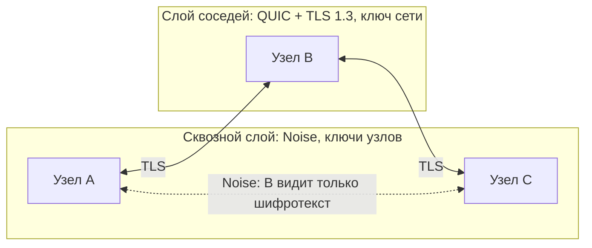

# Безопасность Quokka

Этот документ описывает, от чего защищена сеть, как это устроено и чего защита **не** покрывает.
Внешнего аудита и фаззинга не было. Noise реализован по спецификации с помощью примитивов OpenSSL, но
**не сверялся с официальными тестовыми векторами** и с другими реализациями: совместимость нам не нужна,
однако такая проверка стоит первой в очереди. Всё, что заявлено как проверенное, проверяется тестами в
[`tests/`](../tests).

## Двухслойная защита

В mesh трафик идёт через чужие устройства, поэтому одной защиты соединения недостаточно.

| Слой | Что доказывает | Ключ | От кого защищает |
|---|---|---|---|
| Соседи | «Я член сети» | Общий, выводится из кода | От посторонних |
| Подпись узла | «Я узел с этим идентификатором» | Личный Ed25519, не покидает машину | От участников, выдающих себя за других |
| Сквозной | «Только мы двое читаем это» | Личный X25519 + эфемерный | От промежуточных узлов |

### Ключи

- **Секрет сети** — 128 случайных бит в коде приглашения. Через HKDF-SHA256 из него выводятся ключ
  соседей (Ed25519) и ключ маяков (ChaCha20-Poly1305).
- **Личность узла** — Ed25519 для подписей и X25519 для Noise. Создаются при первом запуске и не передаются.
- **Идентификатор узла** — 128 бит SHA-256 от открытого ключа подписи. Он самоудостоверяющий: присвоить
  чужой идентификатор нельзя, не найдя второй прообраз (2¹²⁸).

### Как проходит подключение между соседями

1. TLS 1.3 с взаимной проверкой: обе стороны предъявляют сертификат на ключе сети и сверяют его отпечаток.
   Кто не знает кода, дальше не пройдёт, и его трафик не обрабатывается.
2. Обмен случайными числами и подписями: сосед доказывает, что владеет ключом своего идентификатора
   именно сейчас. Повторить чужую подпись нельзя. До этого потоки не принимаются, и сосед не учитывается
   в `--listeners`.

### Почему посредник не может вмешаться

Канал идёт по Noise_XX_25519_ChaChaPoly_SHA256 внутри маршрутизируемого потока.

1. **Ключ получателя известен заранее.** Статический ключ приходит из сведений об узле, подписанных его
   личным ключом. Посредник не может выпустить такую подпись, так как идентификатор привязан к ключу.
2. **Подмена рвёт канал.** Если посредник отвечает своим ключом, инициатор сравнит его с картой
   (`SecureChannel::handle_handshake`) и закроет канал до отправки запроса и данных.
3. **Отправитель тоже проверяется.** Отвечающая сторона сверяет ключ инициатора с картой сети.
4. **Заголовок связан с рукопожатием.** Идентификаторы сторон входят в пролог Noise: подмена отправителя или
   получателя в открытом заголовке ломает рукопожатие.
5. **Записи пронумерованы и подлинны.** Счётчик записи входит в nonce: изменить, удалить или переставить
   запись незаметно нельзя.
6. **Обрезание заметно.** Конец данных — это зашифрованная пустая запись. FIN без неё считается обрывом, и
   программа получает ошибку соединения, а не обычный конец данных.
7. **Датаграммы защищены от повтора.** Счётчик в подписанной части и окно на 2048 значений. Окно сдвигается
   только после проверки подлинности.
8. **Прямая секретность.** У каждого канала свои эфемерные ключи: утечка личного ключа или кода не раскрывает
   записанный ранее трафик.

### Карта сети

Каждый узел подписывает сведения о себе: ключи, номер версии, имя, соседей, сервисы.

- **Подделать чужие сведения нельзя**: подпись проверяется, а идентификатор выводится из ключа.
- **Откатить нельзя**: старый номер версии отклоняется.
- **Выдумать связь нельзя**: связь учитывается, только если о ней сообщили оба конца. Участник не может
  притянуть к себе трафик, заявив, что он сосед жертвы, пока жертва этого не подтвердит.
- **Можно соврать о себе**: сообщить о настоящей связи и затем отбрасывать трафик. Это отказ в обслуживании, см.
  ниже.

### Минимум возможностей

- Без `--udp` и `--tcp` запросы к узлу отклоняются. Номер сервиса всегда сверяется со своим списком.
- Без `--open` чужие порты на машине не открываются. Это важно: объявленный порт на `127.0.0.1` может получить
  трафик программ, которые ожидают там что-то своё (например клиент базы данных на 5432, когда база выключена).
- Всё пробрасывается только на `127.0.0.1`: узел не становится шлюзом в локальную сеть. Запросить можно лишь
  свои объявленные порты.

## Что исправлено по сравнению с первой версией

В самой первой версии клиент без ключа подключался к QUIC-порту и получал ответ локального сервиса жертвы
(подтверждено эксплойтом). Сертификаты не проверялись, новое соединение вытесняло активное, SSH был открыт по
умолчанию, очереди не ограничивались. Всё это закрыто и покрыто тестами.

## Что проверено тестами

Запуск: `ctest --test-dir build`. Сценарии в `tests/e2e.py`, проверки кода в `tests/unit_tests.cpp`, злой узел —
обычный код с хуками `QUOKKA_TEST_HOOKS`, которых нет в рабочей сборке.

| Свойство | Проверка |
|---|---|
| Посредник не видит данные TCP и UDP | `scenario_relay_cannot_read`, с контролем, что перехват реально работает |
| Подмена ключа посредником обнаруживается, данные не уходят | `scenario_relay_mitm`, с контролем честного посредника |
| Обрезание потока посредником видно как ошибка | `scenario_relay_truncate`, с контролем штатного конца |
| Хвост данных не теряется при штатном закрытии | `scenario_relay_truncate`: «33 обмена» |
| Участник не выходит за объявленные сервисы | `scenario_member_limits` |
| Клиент без сертификата и клиент без подписи узла отбиты | `scenario_outsiders`, с контролем |
| Узел другой сети не принимается | `scenario_outsiders` |
| Чужие порты не открываются без `--open` | `scenario_every_node_serves` |
| Память ограничена при медленном сервисе, в том числе на посреднике | `scenario_backpressure` |
| Дескрипторы ограничены | `scenario_flow_limit` |
| Изменение любого байта рукопожатия ломает его | `test_noise_rejects_tampering` |
| Ключ малого порядка отклоняется | `test_noise_rejects_tampering` |
| Повтор датаграмм отклоняется | `test_replay_window` |
| Подделка сведений об узле и откат версии отклоняются | `test_node_info_signature`, `test_database_updates` |
| Односторонняя связь не даёт маршрута | `test_routes` |
| Секрет с широкими правами и символическая ссылка отвергаются | `test_state_files` |
| Гонки и ошибки памяти | Все сценарии под TSan и ASan/UBSan, см. ARCHITECTURE.md |

## Что защита не покрывает

Это осознанные ограничения. Часть стоит закрыть, если сеть выйдет за рамки круга знакомых.

| Ограничение | Последствие | Что можно сделать |
|---|---|---|
| **Канал передачи кода** | Кто перехватил код, становится участником | Передавать лично или в зашифрованном чате |
| **Один код на всех, нет отзыва** | Нельзя исключить одного участника. Новая сеть не переносит остальных сама | Членство на подписях вместо общего секрета, см. ARCHITECTURE.md |
| **Участник может объявить любой сервис** | `--open 8000` без узла открывает первый объявленный сервис с этим портом, в том числе злоумышленника | Указывать идентификатор: `--open ab12cd34:8000` |
| **Имена не подтверждены** | Имя узла выбирает сам узел, и оно может совпасть с чужим. `--open имя:порт` доверяет этому | Указывать идентификатор |
| **Создание фиктивных узлов** | Участник может завести сколько угодно идентификаторов и забить карту сети (до 4096 записей) | Подтверждение личности при приёме в сеть |
| **Посредник может отбрасывать трафик** | Участник, через которого идёт путь, может мешать связи. Обход сработает, только если он сам сообщит о разрыве | Измерение доставки по путям |
| **Метаданные видны участникам** | Посредник видит, кто с кем и сколько передаёт. Все участники видят карту сети и номера портов | Луковая маршрутизация, это другой масштаб задачи |
| **Память посредника** | Участник может открыть до 256 транзитных потоков на соединение, примерно до 2 МиБ на поток | Общий бюджет на транзит |
| **Локальный доступ** | Любая программа на устройстве, включая страницы в браузере и других пользователей машины, может обратиться к открытому порту `127.0.0.1` | Сервисы должны иметь свою аутентификацию |
| **Секреты на диске не зашифрованы** | `~/.config/quokka` защищён только правами файлов. Секреты не затираются в памяти | Keychain или Secret Service |
| **Код в аргументах команды** | Попадает в историю shell и ненадолго виден в `ps`. Затем затирается в `argv` | Запускать `quokka join` без кода и вводить по запросу |
| **Отказ в обслуживании в сети** | Атакующий в сети может отбрасывать пакеты и слать поддельные маяки. Доступа это не даёт | `--peer` обходит автопоиск |
| **Номер версии на часах** | Если часы узла ушли назад, его новые сведения будут считаться устаревшими до 3 минут | Хранить номер на диске |

## Правила для разработчиков

Изменения в этих местах нужно делать особенно внимательно:

1. **`QuicSession::verify_peer` и страховка в `CONNECTED`** — единственный допуск к соединению.
2. **`SecureChannel::handle_handshake`** — сверка ключей. Нельзя отправлять запрос до неё.
3. **`handle_hello` и `session->admit()`** — до этого момента потоки не принимаются.
4. **Всё от пира — недоверенное**, даже с верным ключом. Проверяйте длины и индексы, ограничивайте ресурсы.
5. **Открытый заголовок видят все на пути.** Новые поля кладите внутрь Noise, если маршрутизации они не нужны.
6. **Новая цель для ключа — новая метка HKDF.** Один ключ для двух задач не используется, счётчик с одним ключом
   дважды тоже.
7. **Новая предотвращённая атака получает тест с контрольным случаем**: проверка, которая может только проходить,
   ничего не доказывает. Именно контрольный случай нашёл обрыв хвоста данных в ретрансляторе.
